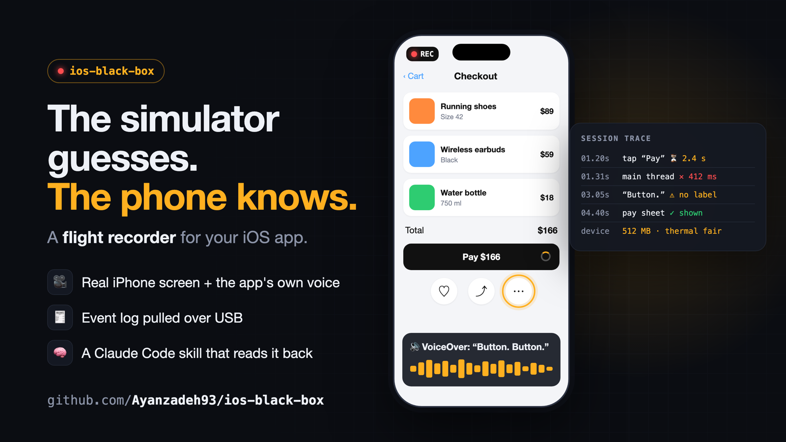

<p align="center"></p>

# ios-black-box

**Turn real iPhone tasks into evidence you can inspect and regression tests you can repeat.**

[](https://github.com/Ayanzadeh93/ios-black-box/actions/workflows/validate.yml)
[](LICENSE)

An agent skill toolkit for testing iOS apps in the conditions their users encounter: camera and ML features outdoors, interrupted audio, checkout retries, workout recovery, AR, accessibility, and indoor or outdoor navigation.

Define the task, capture a short device session, judge the recorded evidence, and preserve a regression fixture. The toolkit provides Debug capture templates and analysis tools; your app supplies its pipeline, task instrumentation, and domain-specific evidence.

## Three skills, one workflow

| Skill | What it does |
|---|---|
| [**ios-field-testing**](skills/ios-field-testing/SKILL.md) | Turns a user task into an editable scenario, evaluates instrumented acceptance checks, and reports **pass**, **fail**, or **inconclusive** with evidence. |
| [**ios-black-box**](skills/ios-black-box/SKILL.md) | Records the screen and app audio with ReplayKit, retrieves app traces, and maps events onto an approximate video timeline. |
| [**ios-sensor-tape**](skills/ios-sensor-tape/SKILL.md) | Records supplied camera frames, optional depth, device motion, and app events, then replays saved inputs through your production adapter. |

The task is generic; physical capture remains specific to iOS. GPS, HealthKit, Bluetooth, network state, payment outcomes, and other domain data need app-specific adapters or independent evidence.

## Install into your app project

Run this from the repository containing your iOS app:

```bash
npx skills add Ayanzadeh93/ios-black-box \
  --skill ios-field-testing ios-black-box ios-sensor-tape \
  --agent codex --yes

export SKILLS_DIR=".agents/skills"
```

Use `--agent claude-code` for Claude Code, or select your agent through the Vercel Skills CLI. Resolve scripts relative to their installed `SKILL.md` if your agent uses another location. The three companion skills are installed explicitly; installing one does not install the others.

**Keep your working directory in the app project for the walkthrough below.** `session.sh build` finds the Xcode project there. If using a source checkout instead of installed skills, set `SKILLS_DIR=/absolute/path/to/ios-black-box/skills` while remaining in your app project.

You can ask your agent:

> Use ios-field-testing to test checkout recovery after losing connectivity. Define measurable checks, capture the relevant evidence, and preserve a regression case. Mark missing evidence inconclusive.

## Start with a measurable task

Choose a starting profile and adapt its steps, event names, sample requirements, and thresholds to your app:

| Profile | Example task | Evidence to collect |
|---|---|---|
| `general` | Complete the primary task after an interruption | Task transitions, outcome, visible recovery |
| `camera-ml` | Recognize labels outdoors after rotating the phone | Labeled frames, orientation/preprocessing, predictions and latency |
| `audio` | Finish an announcement after an interruption | Playback/completion/cancellation events and app audio |
| `commerce` | Recover checkout after connectivity loss | Retry/UI events and independently confirmed order state |
| `fitness` | Resume the same workout after permission denial and lock/unlock | Authorization, lifecycle, persisted workout identity and UI state |

```bash
python3 "$SKILLS_DIR/ios-field-testing/scripts/scenario.py" \
  init checkout.json --profile commerce

# Edit the generated scenario for your app before recording.
python3 "$SKILLS_DIR/ios-field-testing/scripts/scenario.py" validate checkout.json
```

Profiles are editable test plans. Their thresholds are examples, and the evaluator does not execute the human steps. See [scenario design](skills/ios-field-testing/references/scenario-design.md) and the [scenario/trace contract](skills/ios-field-testing/references/scenario-contract.md).

## Capture and evaluate

1. Add [SessionRecorder.swift](skills/ios-black-box/templates/SessionRecorder.swift) to your app target. At launch, inside `#if DEBUG`, call `SessionRecorder.shared.startIfRequested()`.
2. Write app events to `Documents/traces/` as JSON Lines. Use `ProcessInfo.processInfo.systemUptime` for `t`, the scenario's ID for `scenario_id`, and events emitted by the actual task outcomes.
3. Connect an unlocked, paired iPhone to your Mac and run:

```bash
export DEVICE='<device identifier>' BUNDLE='com.example.app'
"$SKILLS_DIR/ios-black-box/scripts/session.sh" doctor
"$SKILLS_DIR/ios-black-box/scripts/session.sh" build
"$SKILLS_DIR/ios-black-box/scripts/session.sh" start 60
# Accept ReplayKit consent, perform the scenario, and let recording finish.
"$SKILLS_DIR/ios-black-box/scripts/session.sh" pull
```

Set `PROJECT`, `WORKSPACE`, or `SCHEME` when build selection needs it; see the [capture guide](skills/ios-black-box/SKILL.md). The recorder captures app audio with the microphone disabled. Optional `ffmpeg`/`ffprobe` analysis adds signal levels, low-level audio intervals, and a contact sheet.

The generated commerce profile expects a trace shaped like this, with timestamps and outcomes from the real run:

```jsonl
{"type":"scenario.start","t":100.0,"scenario_id":"commerce-task"}
{"type":"checkout.completed","t":103.2,"scenario_id":"commerce-task"}
{"type":"scenario.end","t":104.0,"scenario_id":"commerce-task"}
```

Emit `scenario.end` after the task's work settles, then flush the trace including that marker before export. Keep one trace per execution, on the same device/boot clock. A start/end pair declares the observation window; it cannot prove that every relevant event was logged.

```bash
python3 "$SKILLS_DIR/ios-field-testing/scripts/scenario.py" \
  evaluate checkout.json path/to/run-events.jsonl --out result.json
```

| Result | Meaning | Exit code |
|---|---|---|
| **Pass** | The configured checks have sufficient evidence and meet their thresholds. | `0` |
| **Fail** | Observed evidence violates a configured check. | `1` |
| **Inconclusive / invalid input** | Required evidence is missing, incomplete, malformed, or insufficient. | `2` |

Results include observed values, sample counts, source file/line references, coverage, and SHA-256 input hashes. Checks support event counts and numeric `min`, `max`, `median`, and nearest-rank `p95`. Review the media and required manual or backend evidence alongside these checks: one logged completion does not prove one backend order.

### Interrupted tasks and resumed recording

Automatic screen capture starts once per app launch. To capture another foreground segment during the **same app run**, integrate a Debug action calling `SessionRecorder.shared.startNextSegment()` on the main actor after the prior export finishes. The app must be active, normal recorder setup must have run, and `-recordSession YES` must be enabled. Accept fresh ReplayKit consent and verify the saved artifacts; `true` means the request was accepted, not that recording succeeded.

Preserve a continuous app trace across the segments. Both capture scripts' `start` commands terminate and relaunch the app, so use the in-app hook for continuous workout or interruption tests. If resumed screen evidence is unavailable, state that in the result.

## Preserve sensor-dependent failures

For camera, AR, ML, or motion tasks, integrate the [sensor tape templates](skills/ios-sensor-tape/SKILL.md) and offer frames from your existing capture pipeline. To request sensor and screen recording together, launch once with both flags:

```bash
LAUNCH_ARGS="-recordSession YES -recordSeconds 30" \
  "$SKILLS_DIR/ios-sensor-tape/scripts/tape.sh" start 30 5
# Accept consent and perform the scenario; the tape limit starts at activation.
"$SKILLS_DIR/ios-sensor-tape/scripts/tape.sh" pull
"$SKILLS_DIR/ios-black-box/scripts/session.sh" pull
"$SKILLS_DIR/ios-sensor-tape/scripts/tape.sh" validate path/to/tape-directory
```

Structural validation checks metadata, timestamps, sample fields, and referenced assets. Decode every required image/depth asset in the target test environment before accepting the tape as a regression fixture. Replay with the production orientation/preprocessing adapter, reset pipeline state, and assert the behavior that failed. The test template must be connected to your app's pipeline.

For nonsensor tasks, preserve sanitized traces and fixtures or mocks for the relevant state transition. Keep live integration tests for effects those fixtures cannot establish.

## Try the evaluator without a phone

After installing the skills, run the included **synthetic** checkout example:

```bash
python3 "$SKILLS_DIR/ios-field-testing/scripts/scenario.py" evaluate \
  "$SKILLS_DIR/ios-field-testing/evals/fixtures/commerce.json" \
  "$SKILLS_DIR/ios-field-testing/evals/fixtures/commerce-pass.jsonl" \
  --out demo-result.json
```

This returns pass/`0`. Replace the trace filename with `commerce-fail.jsonl` for duplicate completions (fail/`1`), or `commerce-truncated.jsonl` for a missing end marker (inconclusive/`2`). These fixtures demonstrate evaluation behavior; they are not device captures.

## Artifacts and practical limits

With the default output settings, capture and tape retrieval produce:

```text
.blackbox/
  <capture-id>/
    recordings/       screen/app-audio MP4 and clock sidecars
    traces/           app JSONL traces, when available
    timeline.csv      aligned events, when sidecar and traces are available
    report.txt        optional media analysis
    contact.jpg       optional contact sheet
  tapes/tape-<id>/
    meta.json         recorder settings, device and clock metadata
    index.jsonl       frame, motion and app-event samples
    frames/           sampled JPEGs
    depth/            optional compressed Float32 depth maps
```

Multiple screen recordings receive separate analysis filenames. Keep the scenario and evaluation result with the exact inputs they describe. See [evidence and replay](skills/ios-field-testing/references/evidence-and-replay.md) for reporting and retention.

- ReplayKit's callback anchor is approximate. Nearby video and log events do not establish exact synchronization or causality.
- Audio-level analysis does not recognize speech or prove intelligibility; inspect the relevant audio and completion events.
- JPEG compression, sampling, scaling, preprocessing, pipeline state, and model/hardware versions affect replay. Repeatable inputs do not guarantee identical model outputs or recreate live camera timing, heat, or background execution.
- App FPS, thermal state, memory, network conditions, and external outcomes require their stated instrumentation. Tape sampling rate is not app FPS.
- Use short Debug captures and test accounts. Inspect screen, audio, traces, and sensor assets before sharing; publish only reviewed, sanitized fixtures.

## Requirements and verification

Scenario evaluation and structural analysis need **Python 3.9+**. Installing agent skills needs Node.js with `npx`.

Physical capture needs **macOS, Xcode 16.3+ with Swift 6.1+, iOS 17+, a signed Debug app, and a paired iPhone**. The app must supply the relevant usage descriptions and permissions. LiDAR depth requires compatible hardware and an enabled depth source. Install `ffmpeg` and `ffprobe` for media reports.

The extension has **48 automated tests** covering scenario evaluation, trace alignment, tape validation, generated-media analysis, and mocked device commands. CI checks Python 3.9/3.12 on Linux/macOS and Swift 6 typechecking against the iOS simulator SDK. Optional media tests skip when ffmpeg is unavailable. Physical iPhone behavior still needs integration testing. See [validation details](VALIDATION.md).

From a source checkout, run:

```bash
python3 -m unittest discover -s tests -v
```

Contributions with small reproducible scenarios, useful adapters, and sanitized fixtures are welcome. See [CONTRIBUTING.md](CONTRIBUTING.md) for development and helper-skill installation.

MIT © Aydin Ayanzadeh
