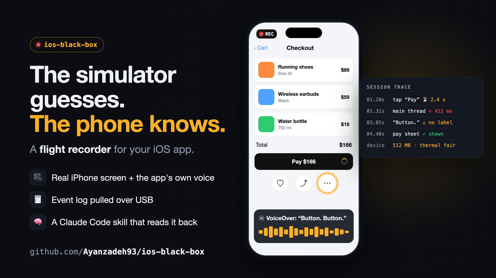

<p align="center"></p>

<h1 align="center">✈️ ios-black-box</h1>

<p align="center"><b>A flight recorder for your iOS app.</b><br>
Record real iPhone sessions (screen + the app's own voice) and get back a timeline of what it showed, said and did.</p>

<p align="center">
  <a href="LICENSE"></a>
  
  
  
  <a href="https://github.com/Ayanzadeh93/ios-black-box/stargazers"></a>
</p>

---

> **The simulator guesses. The phone knows.**
> Cameras, sensors, speech timing, heat and memory only tell the truth on a real device.

## Why

| | Simulator | Screenshots | **ios-black-box** |
|---|:---:|:---:|:---:|
| Real camera, sensors, heat | ❌ | ✅ | ✅ |
| Video, not stills | ✅ | ❌ ~0.4 fps | ✅ |
| Hear what the app said | ⚠️ | ❌ | ✅ app audio |
| Events on the video's clock | ❌ | ❌ | ✅ |
| An agent can read and judge it | ❌ | ❌ | ✅ |

## What you get

- 🎥 **Screen video with app audio**: ReplayKit inside your Debug build; the mic is never recorded
- 🧾 **Your event log alongside it**: JSONL traces pulled from the app container over USB
- 📊 **An instant report**: speech/silence spans, audio level, contact sheet
- ⏱️ **One clock**: every log event mapped onto the video (`timeline.csv`), so a cut-off utterance lines up with the event that interrupted it
- 🧠 **An agent playbook**: `SKILL.md` tells Claude Code (or any coding agent) how to run, read and judge a session

## Quick start

```bash
export DEVICE=<udid> BUNDLE=com.you.app        # xcrun devicectl list devices
skills/ios-black-box/scripts/session.sh build   # signed Debug build + install
skills/ios-black-box/scripts/session.sh start 60 # use the app, then leave it
skills/ios-black-box/scripts/session.sh pull    # → .blackbox/<timestamp>/
```

One-time setup: add [`templates/SessionRecorder.swift`](skills/ios-black-box/templates/SessionRecorder.swift) to your app and call `SessionRecorder.shared.startIfRequested()` at launch (Debug only).
To use it as an agent skill, copy `skills/ios-black-box` into `.claude/skills/` (project) or `~/.claude/skills/` (global).
Full guide: [`SKILL.md`](skills/ios-black-box/SKILL.md).

## 🧰 Skills in the box

| Skill | What it does |
|---|---|
| [**ios-black-box**](skills/ios-black-box/SKILL.md) | Records a real iPhone session (screen + the app's own voice + your event log) and lines it all up on one timeline. |
| [**ios-sensor-tape**](skills/ios-sensor-tape/SKILL.md) | Records the real world once (camera, LiDAR depth, motion), then replays it through your pipeline in tests, identically on every run. |

```bash
skills/ios-sensor-tape/scripts/tape.sh start 30   # walk a real scene
skills/ios-sensor-tape/scripts/tape.sh pull       # → a tape your tests can replay
```

## Battle-tested

On its first real runs, on a navigation app for blind users:

- 🔇 **10 of 16** voice warnings cut off mid-sentence
- 🔁 A phrase spoken twice: *"keyboard ahead, keyboard ahead"*
- 🔥 The phone throttling under heat, down to **6 FPS**
- 🎞️ A 41-second walk became a replay test: 40 real frames through the production detector, identical output on every run

None of it was possible in the simulator alone.

## Requirements

Xcode 16+ · iOS 17+ · a USB-connected iPhone · `ffmpeg` (for reports)

## Contributing

Issues and PRs are welcome, especially analyzers for common trace formats and support for other agents.
If this saves you a bug hunt, **give it a ⭐**: it helps other iOS developers find it.

MIT © Aydin Ayanzadeh
